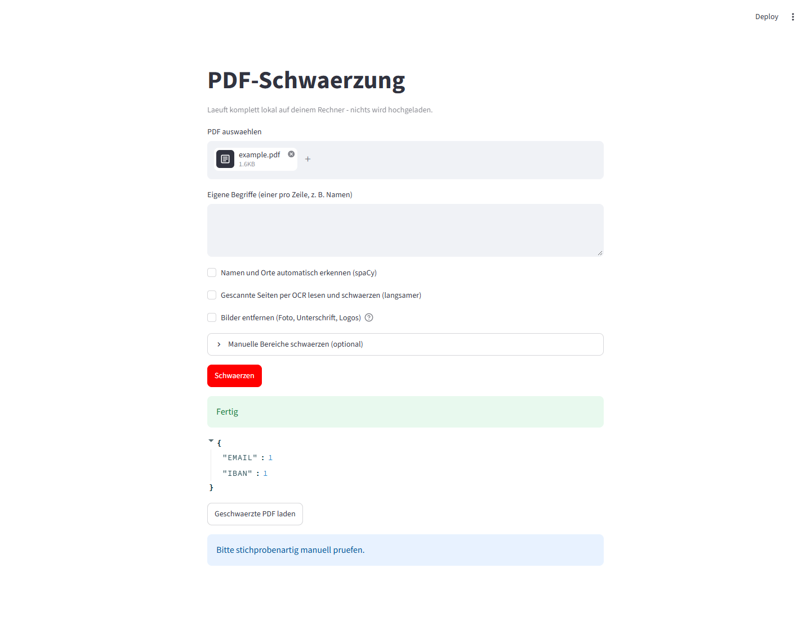
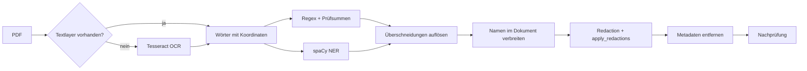

<div align="center">

# PDF PII Redactor

**Personenbezogene Daten in PDFs erkennen und dauerhaft schwärzen. Offline, getestet, mit OCR.**

[](https://github.com/mekanxy-art/pdf-pii-redactor/actions/workflows/tests.yml)


</div>

> **English TL;DR:** A local, offline tool that detects personal data in PDFs (IBAN, e-mail, phone, tax ID, names, ...) and **permanently removes** it from the file, including scanned pages via OCR. Checksum validation keeps false positives low, and a post-redaction check reports anything that slipped through.



## Warum dieses Projekt?

Ein schwarzes Rechteck über Text reicht nicht: Der Text darunter bleibt im PDF oft vollständig kopierbar. Außerdem möchte niemand Lebensläufe, Zeugnisse oder Rechnungen in einen Cloud-Dienst hochladen, nur um sie zu anonymisieren. Dieses Tool entfernt die Inhalte **tatsächlich aus der Datei** und läuft komplett lokal.

## Funktionen

| Bereich | Umsetzung |
|---|---|
| Strukturierte Daten | IBAN (Mod 97), Kreditkarte (Luhn), Steuer-ID (ISO 7064), E-Mail, Telefon, Geburtsdatum |
| Namen und Orte | spaCy (`de_core_news_md`); erkannte Namen werden im ganzen Dokument erneut gesucht, auch in GROSSBUCHSTABEN und als Nachname allein |
| Eigene Begriffe | Beliebige Wörter oder Namen, ohne Rücksicht auf Groß-/Kleinschreibung |
| Scans | OCR per Tesseract; nur die sensiblen Bildbereiche werden geschwärzt, der Rest der Seite bleibt lesbar |
| Bilder | Foto, Unterschrift und Logos entfernen (mit OCR bleiben seitenfüllende Scans erhalten) |
| Manuell | Bereiche in Prozent der Seite, mit Vorschau und Raster |
| Absicherung | Mehrere Durchgänge, Nachprüfung mit Liste möglicher Resttreffer, Metadaten und Anhänge werden gelöscht |
| Bedienung | Weboberfläche (Streamlit, lokal) und Kommandozeile |

## So funktioniert es



## Schnellstart (Windows)

Voraussetzungen: Python 3.12, optional [Tesseract](https://github.com/UB-Mannheim/tesseract/wiki) mit den Sprachdateien `deu` und `eng` für OCR.

```powershell
git clone https://github.com/mekanxy-art/pdf-pii-redactor.git
cd pdf-pii-redactor
python -m venv .venv
.venv\Scripts\python.exe -m pip install -r requirements.txt
.venv\Scripts\python.exe -m spacy download de_core_news_md
.venv\Scripts\streamlit.exe run app.py
```

Ein Testdokument mit erfundenen Daten erzeugst du mit `.venv\Scripts\python.exe make_test.py`. Alternativ liegt unter [samples/example.pdf](samples/example.pdf) ein synthetisches Beispieldokument. Dieses enthält keine echten Kundendaten.

## Nutzung

**Weboberfläche:** PDF hochladen, Optionen wählen, schwärzen, Ergebnis laden. Unter „Manuelle Bereiche" siehst du eine Vorschau mit Raster.

**Kommandozeile:**

```powershell
# Namen, Orte und eigene Begriffe schwärzen, Bilder entfernen, Scans per OCR lesen
.venv\Scripts\python.exe -m pii_redactor.cli in.pdf out.pdf --ner --ocr --remove-images --term "Max Mustermann"

# Manueller Bereich: Seite;links;oben;rechts;unten (Prozent). Seite 1, Streifen von 40 % bis 48 % Höhe
.venv\Scripts\python.exe -m pii_redactor.cli in.pdf out.pdf --region "1;10;40;90;48"
```

Optional lässt sich das Projekt als Paket installieren (`pip install -e ".[ui]"`) und dann mit dem Befehl `pii-redactor` aufrufen.

## Technische Entscheidungen

- **Prüfsummen statt reinem Regex:** Eine beliebige 22-stellige Zahl ist keine IBAN. Mod 97, Luhn und ISO 7064 verwerfen Fehltreffer.
- **Überschneidungen:** Treffer konkurrieren über Score und Länge, damit z. B. eine IBAN nicht zusätzlich als Telefonnummer gezählt wird und eine E-Mail nicht als Namensteil.
- **Mehrere Durchgänge:** Nach dem Schwärzen ändert sich der Kontext für die Namenserkennung, und sie findet oft weitere Treffer. Das Tool wiederholt bis zu dreimal pro Seite.
- **Echte Schwärzung:** Es werden Redaction-Annotationen gesetzt und mit `apply_redactions` angewendet. Dadurch verschwindet der Text aus dem Dokument.
- **Nachprüfung:** Das Ergebnis wird erneut analysiert (bei Scans per OCR). Mögliche Resttreffer erscheinen lokal als Tabelle.
- **Lokal:** Es gibt keine Netzwerkzugriffe. Der Report enthält nur Typ und Anzahl der Treffer, nie Klartext.

## Projektstruktur

```
pii_redactor/
  detectors.py     Regex, Validatoren, Überschneidungen, Namen-Verbreitung
  ner.py           spaCy-Anbindung (optional)
  pdf_redact.py    Schwärzung, OCR, Bilder, Nachprüfung
  regions.py       Parser für manuelle Bereiche
  preview.py       Vorschau mit Raster
  cli.py           Kommandozeile
app.py             Streamlit-Oberfläche
tests/             pytest-Tests
```

## Tests

```powershell
.venv\Scripts\python.exe -m pytest
```

Die Tests prüfen Validatoren, Überschneidungen, Namen-Verbreitung, den Parser der Bereiche und, dass geschwärzter Text im PDF wirklich nicht mehr vorhanden ist. Der OCR-Test wird übersprungen, wenn Tesseract fehlt. Die enthaltene GitHub-Actions-Konfiguration führt den Testsatz bei Pushes und Pull Requests aus. Maßgeblich ist das tatsächliche Ergebnis des jeweiligen Laufs. Der lokale OCR-Test kann bei fehlenden Sprachdaten übersprungen werden; die CI installiert deutsche und englische Sprachdaten ausdrücklich.

## Grenzen

- Keine Erkennung ist fehlerfrei. Ergebnisse immer stichprobenartig prüfen, besonders bei Scans.
- OCR liest Handschrift und Zierschrift schlecht. Für Unterschriften oder verzierte Namen gibt es die manuellen Bereiche.
- Die Namenserkennung ist statistisch und kann Fehltreffer oder Lücken haben.
- Grafiken, die als Vektorpfade gezeichneten Text enthalten, werden nicht gelesen.
- Das Tool ersetzt keine rechtliche Prüfung nach DSGVO.

## Roadmap

- [ ] Weitere Entitäten (Adressen, Kfz-Kennzeichen)
- [ ] Bereiche direkt in der Vorschau aufziehen
- [ ] Weitere Formate (DOCX, Bilddateien)
- [ ] Englisches Sprachmodell zuschaltbar

## Datenschutz und Sicherheit

Das Tool verarbeitet Dateien ausschließlich lokal. In Issues und Pull Requests bitte **niemals echte Dokumente oder personenbezogene Daten** posten, siehe [SECURITY.md](SECURITY.md).

## Mitwirken

Beiträge sind willkommen, siehe [CONTRIBUTING.md](CONTRIBUTING.md). Änderungen stehen im [CHANGELOG](CHANGELOG.md).

## Lizenz und Abhängigkeiten

MIT, siehe [LICENSE](LICENSE). Dieses Repository enthält keine Fremdbibliotheken, sondern listet sie nur als Abhängigkeiten: PyMuPDF (AGPL-3.0 bzw. kommerzielle Lizenz), spaCy (MIT), Streamlit (Apache-2.0), Tesseract (Apache-2.0). Die Lizenzbedingungen der Abhängigkeiten gelten für deren Nutzung.
