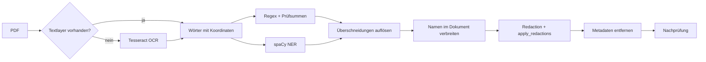

<div align="center">

# PDF PII Redactor

**Personenbezogene Daten in PDFs erkennen und dauerhaft schwärzen. Offline, getestet, mit OCR.**

[](https://github.com/mekanxy-art/pdf-pii-redactor/actions/workflows/tests.yml)


</div>

> **English TL;DR:** A local, offline tool that detects personal data in PDFs (IBAN, e-mail, phone, tax ID, names, ...) and **permanently removes** it from the file, including scanned pages via OCR. Checksum validation keeps false positives low, and a post-redaction check reports anything that slipped through.

## Projekt ansehen oder ausprobieren

**PII** bedeutet *Personally Identifiable Information*, also personenbezogene Daten. Dieses Projekt verbindet eine lokale Python-Oberfläche mit PDF-Verarbeitung, regelbasierter Erkennung, einem deutschen Sprachmodell und automatisierten Tests.

- **Schnell ansehen:** Der Screenshot unten zeigt die Oberfläche und ein Verarbeitungsergebnis. Unter [Technische Entscheidungen](#technische-entscheidungen) steht, wie die Umsetzung funktioniert.
- **Herunterladen:** [Vollständiges Projekt als ZIP](https://github.com/mekanxy-art/pdf-pii-redactor/archive/refs/heads/main.zip) – ohne GitHub-Konto oder Git-Installation.
- **Ausprobieren:** [Windows-Schnellstart](#schnellstart-windows) und [Beispiel-PDF](samples/example.pdf). Python 3.12 und Internet für die erste Einrichtung sind erforderlich; anschließend erfolgt die Dokumentverarbeitung lokal.

GitHub zeigt den Quellcode und diese Vorschau. Die Anwendung selbst läuft nach der Einrichtung auf dem eigenen Rechner; es gibt hier keine gehostete Web-Demo und keine fertige Windows-EXE.


## Warum dieses Projekt?

Ein schwarzes Rechteck über Text reicht nicht: Der Text darunter bleibt im PDF oft vollständig kopierbar. Außerdem möchte niemand Lebensläufe, Zeugnisse oder Rechnungen in einen Cloud-Dienst hochladen, nur um sie zu anonymisieren. Dieses Tool entfernt die Inhalte **tatsächlich aus der Datei** und läuft komplett lokal.

## Funktionen

| Bereich | Umsetzung |
|---|---|
| Strukturierte Daten | IBAN (Mod 97), Kreditkarte (Luhn), Steuer-ID (ISO 7064), E-Mail, Telefon, Geburtsdatum |
| Namen und Orte | spaCy (`de_core_news_md`); erkannte Namen werden im ganzen Dokument erneut gesucht, auch in GROSSBUCHSTABEN und als Nachname allein |
| Eigene Begriffe | Beliebige Wörter oder Namen, ohne Rücksicht auf Groß-/Kleinschreibung |
| Scans | OCR per Tesseract; nur die sensiblen Bildbereiche werden geschwärzt, der Rest der Seite bleibt lesbar |
| Bilder | Foto, Unterschrift und Logos entfernen (mit OCR bleiben seitenfüllende Scans erhalten) |
| Manuell | Bereiche in Prozent der Seite, mit Vorschau und Raster |
| Absicherung | Mehrere Durchgänge, Nachprüfung mit Liste möglicher Resttreffer, Metadaten und Anhänge werden gelöscht |
| Bedienung | Weboberfläche (Streamlit, lokal) und Kommandozeile |

## So funktioniert es



## Schnellstart (Windows)

1. **Python 3.12 installieren**, falls noch nicht vorhanden. Das Projekt wurde mit dieser Version getestet.
2. [Projekt als ZIP herunterladen](https://github.com/mekanxy-art/pdf-pii-redactor/archive/refs/heads/main.zip), im Explorer **Alle extrahieren** wählen und den entpackten Ordner öffnen, der `app.py` enthält.
3. **`start_redactor.bat` doppelklicken.** Der Starter erstellt die lokale Umgebung und installiert Pakete sowie das deutsche Sprachmodell (zusätzlich etwa 44 MB). Der erste Start benötigt Internet und kann mehrere Minuten dauern.
4. Die Oberfläche öffnet sich im Browser. Falls sie sich nicht automatisch öffnet: [http://127.0.0.1:8501](http://127.0.0.1:8501) aufrufen. Das Startfenster während der Nutzung offen lassen; mit **Strg+C** beenden.

Später reicht erneut der Doppelklick. Den Projektordner vollständig zusammenlassen; `.venv` wird auf jedem Rechner neu eingerichtet und gehört nicht ins Repository.

### Erster Funktionstest

1. In der Oberfläche `samples/example.pdf` aus dem entpackten Projekt auswählen. Das Dokument enthält ausschließlich erfundene Daten.
2. Für den ersten Test OCR ausgeschaltet lassen und auf **Schwaerzen** klicken. E-Mail und IBAN werden automatisch erkannt. Die Option für Namen und Orte kann zusätzlich aktiviert werden; eigene Namen lassen sich auch im Textfeld angeben.
3. Auf **Geschwaerzte PDF laden** klicken und die Ergebnisdatei öffnen. Geschwärzte Inhalte dürfen auch beim Kopieren bzw. bei der Textsuche nicht mehr erscheinen. Ergebnisse immer kontrollieren.

### Häufige Startfragen

| Meldung / Situation | Vorgehen |
|---|---|
| Python 3.12 nicht gefunden | Python 3.12 installieren, anschließend den Starter erneut öffnen. |
| Installation scheitert | Internetzugang prüfen und den Starter erneut ausführen. Das Fenster zeigt den konkreten Fehler; fehlende Pakete werden beim nächsten Start erneut eingerichtet. |
| Deutsches Sprachmodell fehlt | App beenden und den aktuellen Starter erneut öffnen. Dieser installiert das Modell automatisch. |
| Port 8501 bereits belegt | Bereits laufende Instanz schließen oder im Projektordner `python start_redactor.py --port 8502` verwenden. |
| OCR funktioniert nicht | OCR ist eine zusätzliche Einrichtung, siehe unten. Für PDFs mit auswählbarem Text ist OCR nicht erforderlich. |

### OCR für gescannte PDFs (optional)

Zusätzlich wird [Tesseract mit deutschen und englischen Sprachdaten](https://github.com/UB-Mannheim/tesseract/wiki) benötigt. Der Starter installiert Tesseract nicht automatisch. Unter Windows wird `C:\Program Files\Tesseract-OCR\tessdata` erkannt. Bei einer anderen Installation `TESSDATA_PREFIX` auf den Ordner setzen, der `deu.traineddata` und `eng.traineddata` enthält. Anschließend den Starter neu öffnen und die OCR-Option aktivieren.

### Alternative: Terminal / macOS / Linux

Unter Windows kann das Repository auch geklont und der gleiche Starter verwendet werden:

```powershell
git clone https://github.com/mekanxy-art/pdf-pii-redactor.git
cd pdf-pii-redactor
py -3.12 start_redactor.py
```

Unter macOS/Linux nach dem Entpacken im Projektordner mit installiertem Python 3.12:

```sh
python3.12 start_redactor.py
```

Auf Linux muss gegebenenfalls das `venv`-Paket zur Python-Installation vorhanden sein. Der Python-Starter unterstützt diese Plattformen; automatisch geprüft werden Windows und Ubuntu. macOS wurde nicht separat getestet. Für OCR werden Tesseract sowie `deu` und `eng` benötigt.

Ein weiteres synthetisches Testdokument erzeugt `.venv\Scripts\python.exe make_test.py` unter Windows (macOS/Linux: `.venv/bin/python make_test.py`).

## Nutzung

**Weboberfläche:** PDF hochladen, Optionen wählen, schwärzen, Ergebnis laden. Unter „Manuelle Bereiche" siehst du eine Vorschau mit Raster.

**Kommandozeile:**

```powershell
# Namen, Orte und eigene Begriffe schwärzen, Bilder entfernen, Scans per OCR lesen
.venv\Scripts\python.exe -m pii_redactor.cli in.pdf out.pdf --ner --ocr --remove-images --term "Max Mustermann"

# Manueller Bereich: Seite;links;oben;rechts;unten (Prozent). Seite 1, Streifen von 40 % bis 48 % Höhe
.venv\Scripts\python.exe -m pii_redactor.cli in.pdf out.pdf --region "1;10;40;90;48"
```

Für die Paketinstallation ist `python -m pip install -e ".[ui]"` möglich; danach steht `pii-redactor` zur Verfügung. Bei diesem Weg muss das Namensmodell bei Bedarf separat mit `python -m spacy download de_core_news_md` installiert werden. Der oben beschriebene Starter übernimmt diesen Schritt automatisch.

## Technische Entscheidungen

- **Prüfsummen statt reinem Regex:** Eine beliebige 22-stellige Zahl ist keine IBAN. Mod 97, Luhn und ISO 7064 verwerfen Fehltreffer.
- **Überschneidungen:** Treffer konkurrieren über Score und Länge, damit z. B. eine IBAN nicht zusätzlich als Telefonnummer gezählt wird und eine E-Mail nicht als Namensteil.
- **Mehrere Durchgänge:** Nach dem Schwärzen ändert sich der Kontext für die Namenserkennung, und sie findet oft weitere Treffer. Das Tool wiederholt bis zu dreimal pro Seite.
- **Echte Schwärzung:** Es werden Redaction-Annotationen gesetzt und mit `apply_redactions` angewendet. Dadurch verschwindet der Text aus dem Dokument.
- **Nachprüfung:** Das Ergebnis wird erneut analysiert (bei Scans per OCR). Mögliche Resttreffer erscheinen lokal als Tabelle.
- **Lokal:** Die Dokumentverarbeitung benötigt nach der Einrichtung keine Internetverbindung. Der Starter bindet die Oberfläche an `127.0.0.1` und deaktiviert Streamlit-Nutzungsstatistiken. Die Ersteinrichtung lädt Pakete und Modell herunter. Der JSON-Report enthält nur Typ und Anzahl der Treffer; mögliche Resttreffer werden in der lokalen Oberfläche bzw. im Terminal als Text angezeigt.

## Projektstruktur

```
pii_redactor/
  detectors.py     Regex, Validatoren, Überschneidungen, Namen-Verbreitung
  ner.py           spaCy-Anbindung (optional)
  pdf_redact.py    Schwärzung, OCR, Bilder, Nachprüfung
  regions.py       Parser für manuelle Bereiche
  preview.py       Vorschau mit Raster
  cli.py           Kommandozeile
app.py             Streamlit-Oberfläche
tests/             pytest-Tests
```

## Tests

```powershell
.venv\Scripts\python.exe -m pytest
```

Die Tests prüfen Validatoren, Überschneidungen, Namen-Verbreitung, den Parser der Bereiche und, dass geschwärzter Text im PDF wirklich nicht mehr vorhanden ist. Der OCR-Test wird übersprungen, wenn Tesseract fehlt. Die enthaltene GitHub-Actions-Konfiguration führt den Testsatz bei Pushes und Pull Requests aus. Maßgeblich ist das tatsächliche Ergebnis des jeweiligen Laufs. Der lokale OCR-Test kann bei fehlenden Sprachdaten übersprungen werden; die CI installiert deutsche und englische Sprachdaten ausdrücklich.

## Grenzen

- Keine Erkennung ist fehlerfrei. Ergebnisse immer stichprobenartig prüfen, besonders bei Scans.
- OCR liest Handschrift und Zierschrift schlecht. Für Unterschriften oder verzierte Namen gibt es die manuellen Bereiche.
- Die Namenserkennung ist statistisch und kann Fehltreffer oder Lücken haben.
- Grafiken, die als Vektorpfade gezeichneten Text enthalten, werden nicht gelesen.
- Das Tool ersetzt keine rechtliche Prüfung nach DSGVO.

## Roadmap

- [ ] Weitere Entitäten (Adressen, Kfz-Kennzeichen)
- [ ] Bereiche direkt in der Vorschau aufziehen
- [ ] Weitere Formate (DOCX, Bilddateien)
- [ ] Englisches Sprachmodell zuschaltbar

## Datenschutz und Sicherheit

Das Tool verarbeitet Dateien ausschließlich lokal. In Issues und Pull Requests bitte **niemals echte Dokumente oder personenbezogene Daten** posten, siehe [SECURITY.md](SECURITY.md).

## Mitwirken

Beiträge sind willkommen, siehe [CONTRIBUTING.md](CONTRIBUTING.md). Änderungen stehen im [CHANGELOG](CHANGELOG.md).

## Lizenz und Abhängigkeiten

MIT, siehe [LICENSE](LICENSE). Dieses Repository enthält keine Fremdbibliotheken, sondern listet sie nur als Abhängigkeiten: PyMuPDF (AGPL-3.0 bzw. kommerzielle Lizenz), spaCy (MIT), Streamlit (Apache-2.0), Tesseract (Apache-2.0). Die Lizenzbedingungen der Abhängigkeiten gelten für deren Nutzung.
